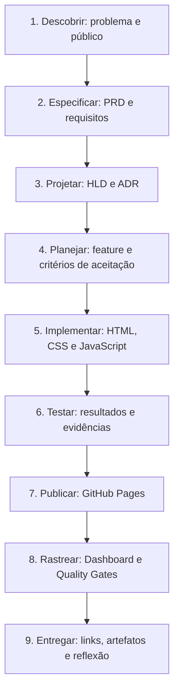

# 🚀 Do Zero ao Portfólio
### Projeto prático guiado pelo SPECTION Framework

**Uma jornada de aprendizagem: especificar, desenvolver, testar e publicar seu portfólio profissional.**

**Centro Universitário CEUNI - FAMETRO | Professor Alexsander Farias**

[📘 Abrir atividade em PDF](./Atividade_Tutorial_Portfolio_SPECTION_FAMETRO.pdf) · [🧭 Conhecer SPECTION](https://alexsandsouza.github.io/spection/) · [🛠️ Project Builder](https://alexsandsouza.github.io/spection/builder/) · [📊 Engineering Dashboard](https://alexsandsouza.github.io/spection/dashboard/)

---

## 📌 Sobre a atividade

Este repositório reúne o roteiro **Do Zero ao Portfólio**, uma atividade prática individual em que cada estudante planeja, implementa, testa e publica um site pessoal responsivo, aplicando o **Spec-Driven Development (SDD)** com o [SPECTION Framework](https://github.com/alexsandsouza/spection).

A proposta conecta **documentação de requisitos, decisões de arquitetura, desenvolvimento web, testes, rastreabilidade e publicação** em uma experiência aplicável à trajetória acadêmica e profissional.

> **Comece pelo PDF:** [Atividade_Tutorial_Portfolio_SPECTION_FAMETRO.pdf](./Atividade_Tutorial_Portfolio_SPECTION_FAMETRO.pdf). Ele contém o passo a passo detalhado, exemplos de código, orientações de segurança e critérios de avaliação.

## 🎯 Objetivos de aprendizagem

Ao final, o estudante deverá ser capaz de:

- Definir o problema, o público-alvo e objetivos verificáveis para um portfólio profissional.
- Elaborar especificações de produto e requisitos funcionais e não funcionais com o **SPECTION Project Builder**.
- Registrar escolhas de arquitetura usando **HLD** e **ADR**.
- Criar uma página responsiva com **HTML5, CSS3 e JavaScript**.
- Executar testes, produzir evidências e acompanhar a rastreabilidade no **SPECTION Engineering Dashboard**.
- Versionar o projeto no **GitHub** e publicá-lo com **GitHub Pages**.

## 🧰 Ferramentas e recursos

| Ferramenta | Utilização |
| --- | --- |
| [SPECTION Framework](https://alexsandsouza.github.io/spection/) | Método e documentação orientados por especificações |
| [SPECTION Project Builder](https://alexsandsouza.github.io/spection/builder/) | Planejamento e exportação de documentos |
| [SPECTION Engineering Dashboard](https://alexsandsouza.github.io/spection/dashboard/) | Kanban, requisitos, testes e rastreabilidade |
| [GitHub](https://github.com/) | Repositório e versionamento |
| [GitHub Pages](https://docs.github.com/pt/pages) | Publicação do portfólio |
| [Visual Studio Code](https://code.visualstudio.com/) | Edição dos arquivos HTML, CSS e JavaScript |
| Navegador moderno | Testes de visualização e responsividade |

**Pré-requisitos:** computador com acesso à internet, conta no GitHub, editor de código e navegador. O exemplo básico não exige Node.js, banco de dados nem hospedagem paga.

## 🗺️ Jornada do projeto

### Etapas resumidas

1. **Descobrir:** descrever um problema real, usuários-alvo e metas de sucesso.
2. **Especificar:** detalhar as seções, os requisitos funcionais e os requisitos de qualidade do site.
3. **Projetar:** justificar a escolha de HTML/CSS/JavaScript, registrar riscos e cuidados de segurança.
4. **Planejar:** criar a primeira funcionalidade e seus critérios de aceitação.
5. **Implementar:** gerar documentação no Builder, organizar o repositório e desenvolver `index.html`, `style.css` e `script.js`.
6. **Testar:** verificar carregamento, navegação, visualização em telas pequenas, links e uso do teclado.
7. **Publicar:** configurar o GitHub Pages, abrir a URL pública e testar a versão publicada.
8. **Registrar evidências:** relacionar requisitos, tarefas e testes no Dashboard, mantendo pendências reais como pendências.
9. **Entregar:** compartilhar os arquivos e links definidos no roteiro oficial.

## 📦 Entregáveis no Google Classroom

- Link público do portfólio no **GitHub Pages**.
- Link público do **repositório GitHub** com o código e os commits.
- **ZIP** exportado do Project Builder com os documentos iniciais.
- **JSON** exportado do Engineering Dashboard com tarefas e evidências reais.
- **Relatório de até duas páginas** (PDF ou documento) com três capturas de tela, tabela de testes e reflexão sobre dificuldades e soluções.

Identifique a entrega com nome acadêmico, turma, título do projeto e URLs. **O prazo será informado pelo professor no Google Classroom.**

## 🧮 Avaliação

| Critério | Pontuação |
| --- | ---: |
| Problema, objetivos e especificações SPECTION | 2,0 |
| Projeto e arquitetura (HLD/ADR) | 1,5 |
| Portfólio funcional e responsivo | 3,0 |
| GitHub e publicação | 1,0 |
| Testes e rastreabilidade | 1,5 |
| Organização, originalidade e reflexão | 1,0 |
| **Total** | **10,0** |

## 🔒 Integridade acadêmica, privacidade e uso de IA

- Use **informações verdadeiras** sobre sua formação, seus projetos e suas competências; projetos acadêmicos são válidos.
- Não publique documentos pessoais, endereço residencial, senhas, tokens ou dados sensíveis.
- Respeite licenças de conteúdo e obtenha autorização para imagens de terceiros.
- A IA generativa pode ser usada como apoio, quando permitido pelo professor, mas seu uso deve ser declarado. **Revise, compreenda e teste** qualquer código sugerido.
- Não registre testes como aprovados sem executá-los. Evidências e lacunas devem refletir o estado real do projeto.

## 📚 Material da aula

| Arquivo | Conteúdo |
| --- | --- |
| [📄 Atividade_Tutorial_Portfolio_SPECTION_FAMETRO.pdf](./Atividade_Tutorial_Portfolio_SPECTION_FAMETRO.pdf) | Tutorial integral da atividade, exemplos de implementação, entrega e rubrica |

> **Nota:** este repositório disponibiliza o **material didático**, não um portfólio pronto. Cada estudante deve criar e publicar seu próprio projeto.

## 🔗 Referências e apoio

- [SPECTION - repositório do framework](https://github.com/alexsandsouza/spection)
- [SPECTION Project Builder](https://alexsandsouza.github.io/spection/builder/)
- [SPECTION Engineering Dashboard](https://alexsandsouza.github.io/spection/dashboard/)
- [GitHub Docs - GitHub Pages](https://docs.github.com/pt/pages)
- [MDN - Aprendendo desenvolvimento web](https://developer.mozilla.org/pt-BR/docs/Learn_web_development)

---

**Elaboração didática:** Prof. Alexsander Farias de Souza  
**Instituição:** Centro Universitário CEUNI - FAMETRO  
**Ano:** 2026

*Especificar → Projetar → Implementar → Testar → Evidenciar → Evoluir*

